<p align="center">
  
</p>

<h1 align="center">Herdr UI</h1>

<p align="center">
  <a href="https://github.com/penso/herdr-gpui/actions/workflows/ci.yml"></a>
</p>

<p align="center">
  <a href="https://herdrui.dev"><b>herdrui.dev</b></a> ·
  <a href="https://github.com/penso/herdr-gpui/releases">Releases</a> ·
  <a href="docs/updating.md">App updates</a> ·
  <a href="docs/cli.md">Command line</a> ·
  <a href="crates/herdr-gpui/README.md">GUI scope &amp; configuration</a> ·
  <a href="crates/herdr-gpui/PERFORMANCE.md">Performance report</a> ·
  <a href="AGENTS.md">Contributing</a> ·
  <a href="#star-history">Star history</a>
</p>

A native Rust/GPUI client for macOS, Linux, and Windows, for a
[Herdr](https://herdr.dev/) daemon you installed yourself. It paints the daemon's terminal cells, split panes included, without
running another terminal emulator or wrapping the TUI.

> **Unaffiliated project.** Not affiliated with, endorsed by, or supported by
> Herdr or [herdr.dev](https://herdr.dev/).

## Gallery

<p align="center">
  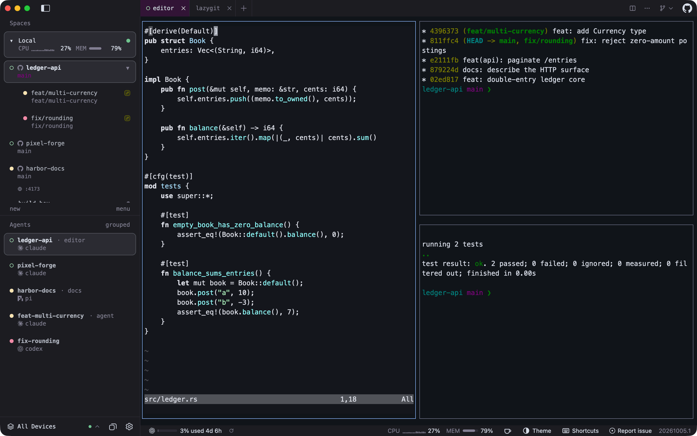
  <br>
  <sub><b>Workspaces, worktrees, and agents in one sidebar.</b> Each agent carries the daemon's status dot (idle, working, or waiting on you), and tabs and splits are painted natively from the daemon's cells.</sub>
</p>

<table>
  <tr>
    <td width="50%" valign="top">
      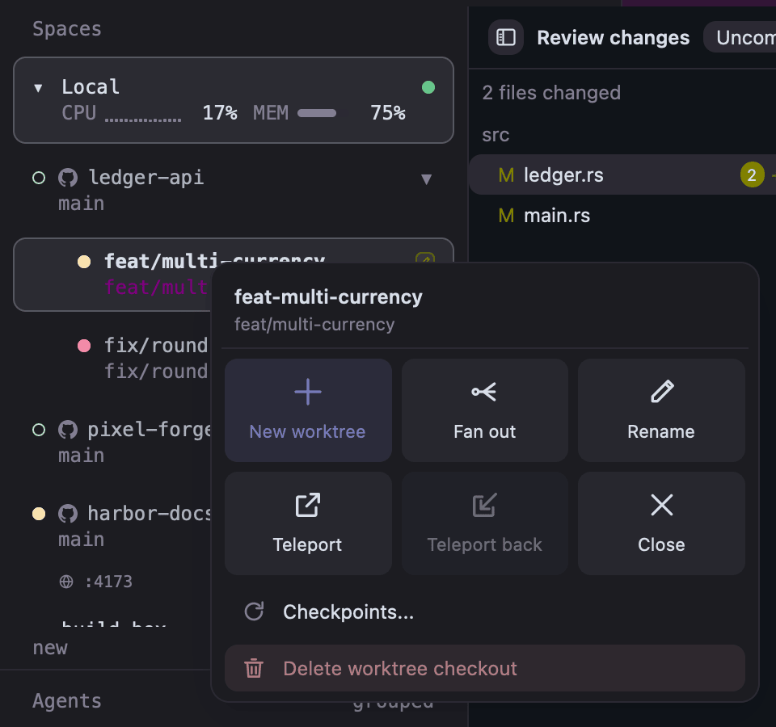
      <br>
      <sub><b>Worktree popover.</b> Right-click a workspace or worktree for a new worktree, fan out, rename, Teleport, checkpoints, close, or delete the checkout.</sub>
    </td>
    <td width="50%" valign="top">
      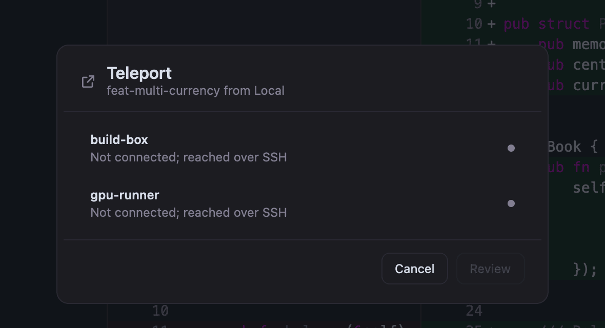
      <br>
      <sub><b><a href="crates/herdr-gpui/README.md#teleport">Teleport</a>.</b> Move a worktree to another host with its commits, uncommitted changes, tabs, splits, running programs, and agent sessions.</sub>
    </td>
  </tr>
  <tr>
    <td colspan="2">
      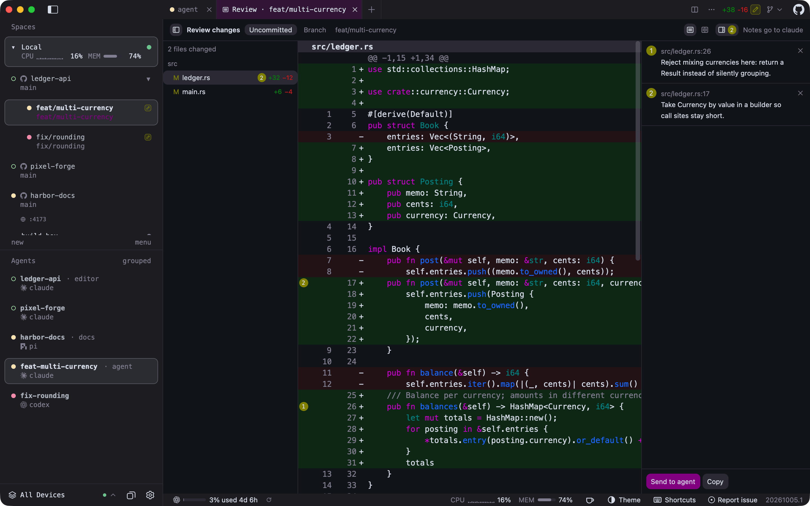
      <br>
      <sub><b><a href="crates/herdr-gpui/README.md#reviewing-an-agents-changes">Review an agent's changes</a>.</b> Open <b>Review Changes</b> from a tab strip's <b>+</b> menu, click any line to leave a note like a pull request comment, then <b>Send to agent</b>.</sub>
    </td>
  </tr>
  <tr>
    <td colspan="2">
      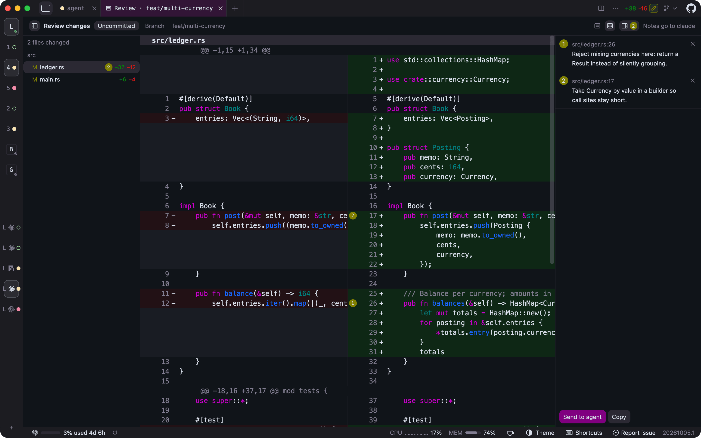
      <br>
      <sub><b>Side-by-side diffs and a collapsed sidebar.</b> Switch the review to side by side, and fold the sidebar to a rail that keeps every workspace and agent one click away.</sub>
    </td>
  </tr>
  <tr>
    <td colspan="2">
      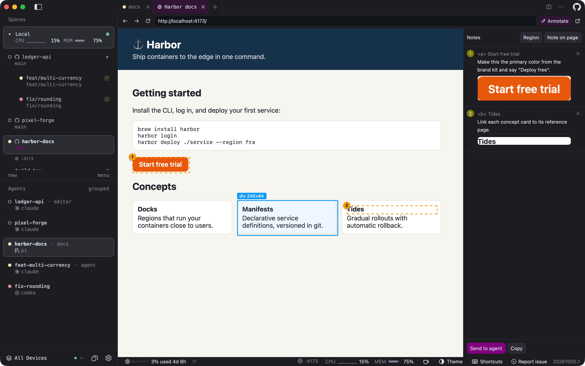
      <br>
      <sub><b><a href="crates/herdr-gpui/README.md#annotating-a-page">Browser tabs with annotations</a>.</b> An agent opens its page with <code>herdr-gpui browser open</code>; you pick elements or regions, write notes, and send them back to that agent. Listening ports such as <code>:4173</code> appear under their workspace.</sub>
    </td>
  </tr>
  <tr>
    <td colspan="2">
      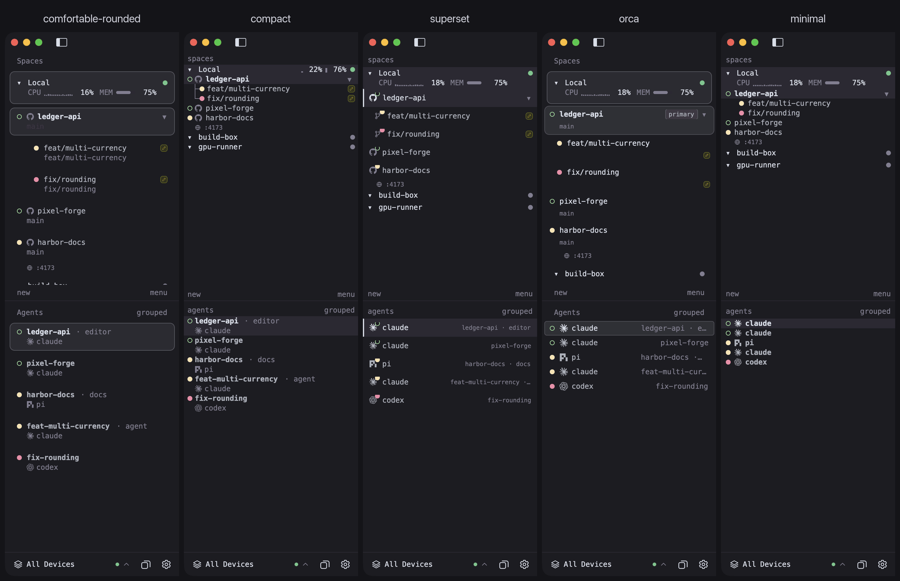
      <br>
      <sub><b>Sidebar layouts.</b> Pick a density or a design of its own from <b>View &gt; Layout</b> or Settings; the choice applies live.</sub>
    </td>
  </tr>
  <tr>
    <td width="50%" valign="top">
      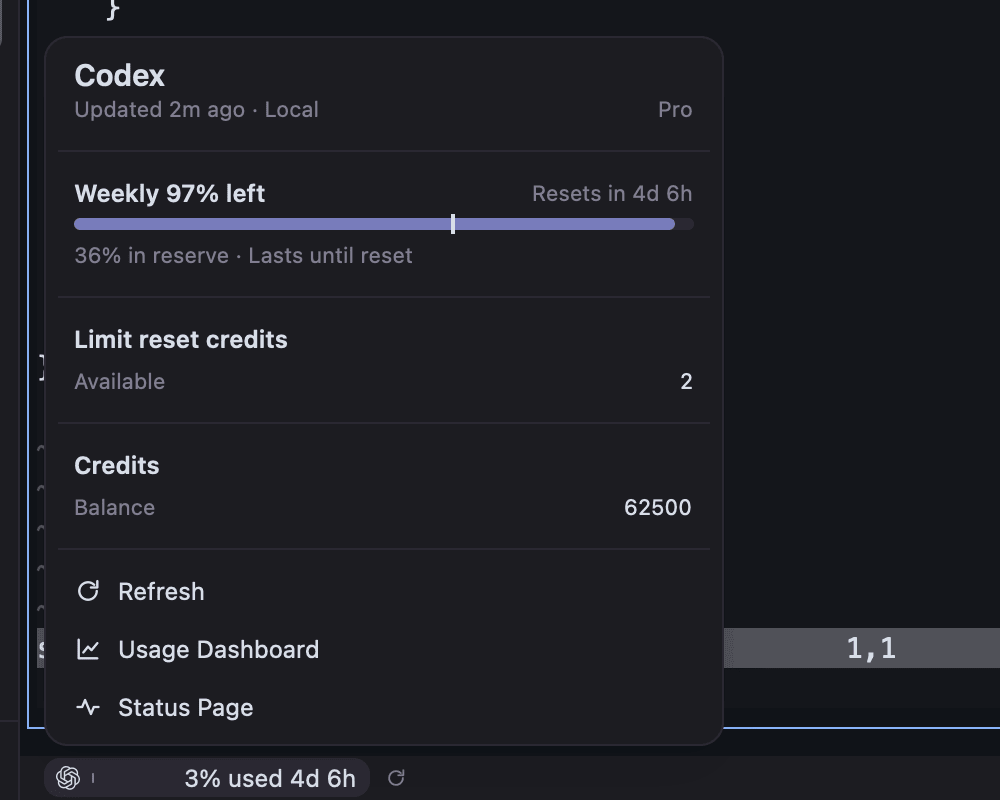
      <br>
      <sub><b><a href="docs/usage-providers.md">Plan usage</a>.</b> The status bar shows the signed-in AI services closest to their limits; click one for the details.</sub>
    </td>
    <td width="50%" valign="top">
      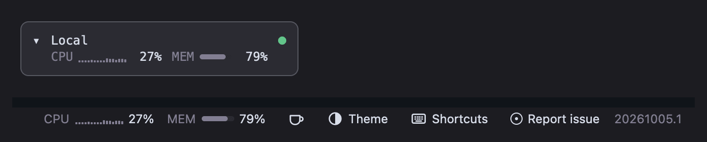
      <br>
      <sub><b>CPU and memory per host.</b> The status bar follows the selected host, and with several hosts each sidebar host row shows its own, read over SSH for remote machines. NVIDIA, AMD, and Apple GPUs and their video memory can be turned on for the status bar and, on a line of their own, the sidebar.</sub>
      <br><br>
      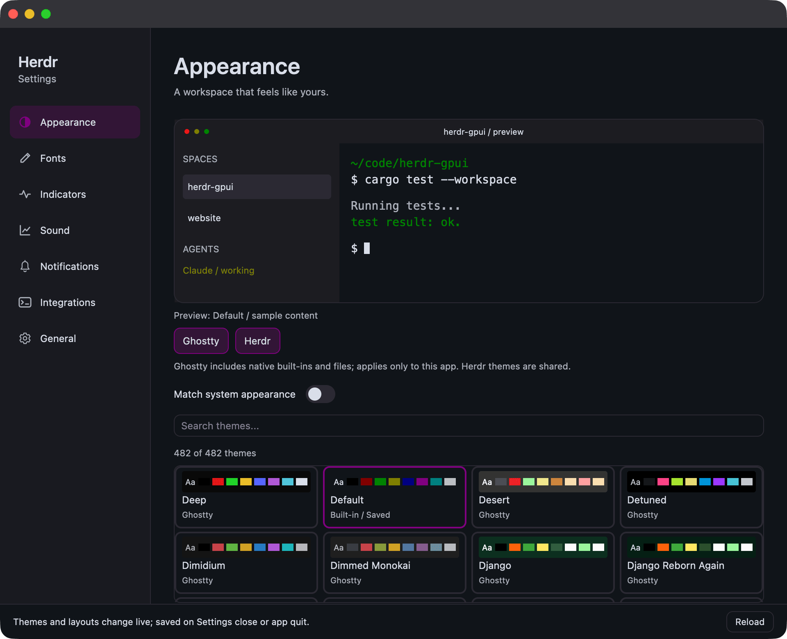
      <br>
      <sub><b>Native settings.</b> Grouped, searchable pages for themes, sidebar, fonts, tabs, notifications, and integrations; every change applies live to the open windows, and hovering a theme previews it in the app.</sub>
      <br><br>
      
      <br>
      <sub><b>Sidebar page.</b> Pick the layout and selection marks, tune spacing with sliders, and give each host its own colour.</sub>
    </td>
  </tr>
  <tr>
    <td colspan="2">
      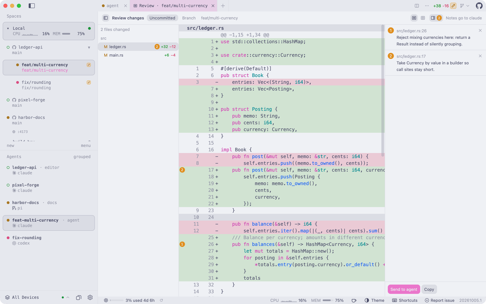
      <br>
      <sub><b>Light or dark, or both.</b> Any theme, or a light and dark pair that follows the system appearance; status colours keep their contrast on either.</sub>
    </td>
  </tr>
</table>

Also included: saved SSH hosts with [file copies](crates/herdr-gpui/README.md#ssh-file-copies),
[inline images](crates/herdr-gpui/README.md#images),
[clickable links](crates/herdr-gpui/README.md#terminal-links),
[code navigation](crates/herdr-gpui/README.md#code-navigation) that jumps to a
symbol, file, or printed `path:line` in your terminal editor,
[file drops](crates/herdr-gpui/README.md#file-drops),
[editor groups](crates/herdr-gpui/README.md#editor-groups), and
[system notifications](crates/herdr-gpui/README.md#system-notifications),
[sounds](crates/herdr-gpui/README.md#notification-sounds), and a
[Dock badge](crates/herdr-gpui/README.md#macos-dock-badge) (on Windows, a
[taskbar badge](crates/herdr-gpui/README.md#windows-shell)) when an agent needs you.

## Install

Install the [Herdr](https://herdr.dev/) daemon first; this app is only its client.
It starts an already-installed local `herdr server` when the target session is
absent, but never installs or upgrades a daemon. Explicitly confirming session
deletion stops that named session first; closing or removing the GUI leaves
daemon sessions and shared Herdr configuration intact.

Then install the latest stable release:

| Platform | Command |
| --- | --- |
| macOS | `brew install penso/tap/herdr-gpui` |
| Linux (APT, DNF or pacman) | `curl -fsSL https://herdrui.dev/install.sh \| sh` |
| Windows (PowerShell) | `irm https://herdrui.dev/install.ps1 \| iex` |

Details, manual downloads, and other methods follow. Coding agents can read
[herdrui.dev/llms.txt](https://herdrui.dev/llms.txt) for the same steps.

### macOS with Homebrew

Requires [Homebrew](https://brew.sh/) and macOS 14.2 Sonoma or newer, on Apple
Silicon or Intel. The cask installs the signed, notarized universal app.

```sh
brew install penso/tap/herdr-gpui
open -a Herdr
```

`brew install` resolves casks directly, so `--cask` is not required. To update it
later, or to install by its short name, tap once first:

```sh
brew tap penso/tap
brew install herdr-gpui
```

The cask is published from the [tap](https://github.com/penso/homebrew-tap) by the
release workflow. A cask install updates itself through Homebrew: the in-app
updater detects that Homebrew owns the bundle and runs `brew upgrade --cask
herdr-gpui` for you, so Homebrew's records stay correct. If its metadata is stale,
the updater runs `brew update` and retries once. The update panel shows progress
throughout. macOS `.dmg`, Linux packages, and Windows installers
and `.zip`s are also published on [Releases](https://github.com/penso/herdr-gpui/releases).

Betas are published as GitHub prereleases before being promoted to stable. To try
them, turn on **Settings > General > Install beta releases**
(`[updates] channel = "beta"`); turning it off never downgrades. Betas never reach
the Homebrew tap, so a Homebrew install updates in place while the setting is on,
and Homebrew takes it back at its next upgrade.

### Linux packages

Each release publishes x86_64 and ARM64 builds as a `.deb`, an `.rpm`, an Arch
Linux package, and a plain tarball, all containing the same executable. They need
glibc 2.39 or newer (Ubuntu 24.04, Debian 13, Fedora 40, current Arch, or later).
The install script picks the package for your architecture and package manager,
checks it against the release's published SHA-256, and installs it with `sudo`:

```sh
curl -fsSL https://herdrui.dev/install.sh | sh
```

Read it first at [`site/install.sh`](site/install.sh). To install by hand instead,
download the file for your architecture from
[Releases](https://github.com/penso/herdr-gpui/releases), then:

```sh
sudo apt install ./Herdr-VERSION-x86_64-unknown-linux-gnu.deb      # Debian, Ubuntu
sudo dnf install ./Herdr-VERSION-x86_64-unknown-linux-gnu.rpm      # Fedora
sudo pacman -U Herdr-VERSION-x86_64-unknown-linux-gnu.pkg.tar.zst  # Arch Linux
```

The package manager pulls in the runtime libraries, including the Vulkan loader;
a Vulkan driver for your GPU must also be present. **App Updates** detects which
package manager owns the installed executable, downloads the matching `.deb`,
`.rpm`, or Arch package, verifies its signed release metadata and checksum, then
installs it through APT, DNF, or pacman with a PolicyKit authentication prompt.
The authorized helper verifies and installs a protected root-owned copy.
Choose **Restart** after installation; daemon and terminal sessions stay running.
This requires `pkexec` and your desktop's PolicyKit authentication agent. Older
builds that report “Package-managed installations cannot self-update” need one
manual package upgrade to gain this support. Before a release, CI installs each package on Ubuntu 24.04,
Debian 13 and Fedora 42, and the x86_64 Arch package on Arch Linux, then checks that
the executable finds every library. The ARM64 Arch package targets Arch Linux ARM
and is not install-tested.

On NixOS, or anywhere with Nix, build from source with the repository's flake:

```sh
nix run github:penso/herdr-gpui
# or add it to a configuration: inputs.herdr-gpui.url = "github:penso/herdr-gpui";
# then environment.systemPackages = [ inputs.herdr-gpui.packages.${system}.default ];
```

The flake builds with the toolchain pinned in `rust-toolchain.toml` on x86_64 and
ARM64 Linux. Like the packages, it never updates itself.

### Windows installers

In PowerShell, on x86_64 or ARM64:

```powershell
irm https://herdrui.dev/install.ps1 | iex
```

The script ([`site/install.ps1`](site/install.ps1)) downloads the zip for your
architecture, checks its published SHA-256, installs `herdr-gpui.exe` and
`herdr-gpui-launcher.exe` under `%LOCALAPPDATA%\Programs\Herdr UI`, adds that
directory to your user `PATH`, and creates a **Herdr UI** Start menu shortcut
that opens the launcher. Prefer a regular installer? Each
[release](https://github.com/penso/herdr-gpui/releases/latest) also has
`Herdr-VERSION-x86_64-pc-windows-msvc-setup.exe` and
`Herdr-VERSION-aarch64-pc-windows-msvc-setup.exe`, which install the same files
to the same place for the current user, without administrator rights, and add
an uninstaller under **Settings > Apps**. Either way, the app updates itself
from **Check for Updates**: it downloads the new installer, checks it against
the release's signed manifest and its Authenticode publisher, runs it silently,
and reopens. See [Windows](#windows) for what works on the platform.

Both add **Open in Herdr UI** to folders in File Explorer, and to the empty
space inside one, for your user only. It runs `herdr-gpui open` on the folder
through the launcher, so no console window appears: the running app focuses
the folder's workspace or starts one there, and the app is started first when
it is not running. On Windows 11 the entry is under **Show more options**,
because the compact menu only lists commands of packaged apps. To remove
everything `install.ps1` added, run it with `-Uninstall`:

```powershell
& ([scriptblock]::Create((irm https://herdrui.dev/install.ps1))) -Uninstall
```

Uninstalling the regular installer from **Settings > Apps** removes the entry
too.

### From source

Install Rust/rustup and, on macOS, the Xcode command-line tools. The repository
pins Rust 1.96.1 and GPUI 0.3.6 (the `gpui-pre` snapshot crate); the Rust version
is declared in `rust-toolchain.toml` and mirrored in `mise.toml`, so `mise install`
also provisions it.

```sh
git clone https://github.com/penso/herdr-gpui.git
cd herdr-gpui
just run
```

`just run` uses the optimized release build with the QA menu enabled;
`just run-debug` is notably slower with a dense terminal on screen.
On macOS both build a local bundle identified as `so.pen.herdr-gpui.dev`, so
it never shares a Dock tile or icon cache with an installed release.
Without `just`: `cargo run --locked --release -p herdr-gpui --features qa-menu`.

To compile and install the optimized executable on macOS, Linux, or Windows:

```sh
just install
```

This installs `herdr-gpui` (`herdr-gpui.exe` on Windows, with
`herdr-gpui-launcher.exe` beside it to open the app without a console window)
into Cargo's bin directory, normally `~/.cargo/bin` or
`%USERPROFILE%\.cargo\bin`, and replaces an earlier installation. Keep that directory on `PATH`; set `CARGO_INSTALL_ROOT`
to use a different installation root (the executable goes in its `bin` directory).
The build uses the pinned lockfile and default features, without the QA menu.
On macOS this installs the standalone executable; use Homebrew above for the
full app bundle. Linux needs the build dependencies below; Windows needs the
Visual Studio C++ build tools and Windows SDK for the MSVC Rust toolchain.
Without `just`: `cargo install --locked --force --path crates/herdr-gpui --bin herdr-gpui`.

Running `cargo test` or `just ci` on Unix also requires `python3` and `jq` on
PATH: the usage-provider tests exercise each JSON parser explicitly. The Ubuntu
dependency helper below installs both; on macOS, use `brew install python jq`.

### Linux Builds

Application shortcuts use **Ctrl+Shift** on Linux, including Ctrl+Shift+T for a
new tab and Ctrl+Shift+C/V for copy/paste, and Windows uses the same profile.
Customize them from **Herdr > Keyboard Shortcuts**; see
[keyboard shortcuts](crates/herdr-gpui/README.md#keyboard-shortcuts).

On Ubuntu 24.04 (x86_64 or ARM64), run `bash scripts/install-linux-deps.sh`
before building. This installs GPUI's X11/Wayland/font development dependencies
and `libasound2-dev` for Rodio/CPAL native audio. CI and release builds use the
same script. Linux binaries require the system ALSA shared library (`libasound2t64`
on Ubuntu 24.04), a configured default audio device, and Vulkan for rendering.
Audio normally routes through the desktop's ALSA plugin configuration; no CLI
audio player is required. Custom notification sounds are MP3 only. See
[notification sounds](crates/herdr-gpui/README.md#notification-sounds).

### Windows

Windows is tested natively. On every change, CI checks
formatting, lints every target and feature, and runs workspace tests with default
and all features on `windows-2025` (x86_64) and `windows-11-arm` (ARM64). On the
same two runners it also opens real windows in a desktop session for the native
sidebar, notification, and paint-probe fixtures. On x86_64 it runs the live GUI
test against a pinned, checksummed Herdr `herdr.exe` in an isolated sandbox,
which creates tabs, splits and workspaces with the keyboard, types into a
PowerShell pane and reads its output back, resizes the window, reconnects,
follows a workspace another client pushes, and opens a second window. Herdr
publishes no ARM64 Windows build, and under x64 emulation its panes do not act
on Enter, so the live test is not run on ARM64. A release-mode run then holds the dense
terminal's hover, scroll, and redraw frames to a p95 budget with real Win32 mouse
and wheel messages. The release workflow installs and uninstalls both signed
installers. Hosted runners have no GPU, so CI proves rendering on Direct3D's
software rasterizer; IME composition, the clipboard, and taskbar pinning are
still checked by hand ([Windows QA](docs/windows-qa.md)).

Local connections use the named pipe the Windows daemon binds, and configuration and
state follow its `%APPDATA%` / `%LOCALAPPDATA%` layout. `herdr-gpui COMMAND`
reaches the running app over a named pipe that only
your Windows user can open and that rejects remote clients; see
[the command line](docs/cli.md#windows). A Herdr daemon inside a
WSL distribution can be added as a device from **Add Device…**; see
[WSL distributions](crates/herdr-gpui/README.md#wsl-distributions). GitHub
sign-ins are saved in Windows Credential Manager and avatars are cached under
`%LOCALAPPDATA%\herdr`; see
[saved sign-ins and the avatar cache](crates/herdr-gpui/README.md#saved-sign-ins-and-the-avatar-cache).
Saved SSH hosts are unavailable and report that plainly; see
[the GUI README](crates/herdr-gpui/README.md#windows). Shortcuts use Ctrl, not
the Win key, with the Linux defaults (Ctrl+Shift+T, Ctrl+Shift+P,
Ctrl+Shift+Q); see
[keyboard shortcuts](crates/herdr-gpui/README.md#keyboard-shortcuts). The
taskbar button shows a badge while agents need you and progress for long
operations, the jump list offers recent workspaces and devices, clicking a
notification brings its pane forward, and both installers register
`herdr-gpui://` links that open a checkout or a device in the running app; see
[Windows shell](crates/herdr-gpui/README.md#windows-shell).

Windows keep the system title bar, so Snap Layouts, drag-to-snap, and the
window menu are the system's own; the title bar follows the app's light or dark
theme. On Windows 11 a translucent window can blur with acrylic or Mica, and
`accent = "system"` takes the accent from Windows. Narrator and other screen
readers get the terminal's text and the title bar and tab strip controls by
name; [what is not exposed yet](crates/herdr-gpui/README.md#screen-readers-on-windows)
is listed there.

Each release publishes `Herdr-VERSION-x86_64-pc-windows-msvc.zip` and
`Herdr-VERSION-aarch64-pc-windows-msvc.zip` (native ARM64), each containing
`herdr-gpui.exe`, `herdr-gpui-launcher.exe`, and their license notices, beside
the matching `-setup.exe` installers. They carry the same checksums, Sigstore
signatures, and build provenance as the other assets. Once Windows signing is
set up, both executables, the installers, and their uninstaller are
Authenticode-signed, and a release publishes only after Windows accepts those
signatures; until then they ship unsigned, are not submitted to winget, and do
not update themselves (see
[`scripts/release/README.md`](scripts/release/README.md#windows-signing)). A
signed copy installed by the installer, winget, or the
[install script](#windows-installers) updates itself in the app: the
installer it downloads must match the release's
Ed25519-signed `windows-manifest.json` and carry a valid signature from Herdr
UI's publisher, or it never runs (see
[App Updates](docs/updating.md#windows-installers)). The app registers with
Restart Manager, so an update, or a restart with **Restart apps** turned on,
reopens it. **Settings > General > Launch at login** (off by default) opens it
when you sign in; see [launch at login](crates/herdr-gpui/README.md#launch-at-login).
A crash leaves a minidump and a text report beside the log, never uploaded; see
[crash reports](crates/herdr-gpui/README.md#crash-reports). A copy run from anywhere else does not update itself; download each
new release manually. `herdr-gpui.exe` is a console program, because it is also the
command line agents and scripts run. Open the app with
`herdr-gpui-launcher.exe` (the Start menu shortcut's target), which starts
`herdr-gpui.exe` without a console window.

## How it connects

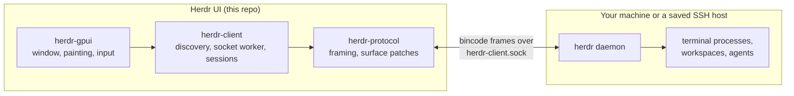

The daemon owns the terminals and all session state. The GUI attaches to the
binary **client** socket, renders the surfaces it is sent, and sends semantic
input back. Closing or detaching the GUI leaves the daemon and its terminals
running.

[Browser tabs](crates/herdr-gpui/README.md#browser-tabs) are the exception:
Herdr has no browser panes, so web pages shown beside a workspace's terminals
belong to the GUI alone. Agents in your panes open them with
`herdr-gpui browser open URL`, which reaches the running app over a local
socket of its own. The same [command line](docs/cli.md) reaches the rest of
what only the GUI keeps: its windows and tabs, worktree notes, checkpoints,
forwarded ports, and its settings.

## Audio Test

The QA menu is excluded from default Cargo builds, including published releases.
`just run` enables it automatically; with Cargo, use
`cargo run --locked --release -p herdr-gpui --features qa-menu`.
To manually test native audio in that build, choose **QA > Play Sound**. It plays the built-in
Done sound on the background Rodio worker, even without a daemon or active pane
and even with notifications muted. `HERDR_DISABLE_SOUND` and `NEXTEST` still
suppress playback. See [notification sounds](crates/herdr-gpui/README.md#notification-sounds)
for queue limits and playback details.

## Performance

`just test-perf` opens a daemon-free native fixture with a dense 160x50 terminal,
40 workspaces, and 40 agents. It dispatches real window-local mouse/scroll events
and measures cold frames, warm hover, and both sidebar lists' scrolling. It also
asserts that unchanged terminal cells need zero new text-shaping calls, validates
batched background counts, and compares cached glyphs with freshly shaped ones.

On the development M4 Max, caching and background batching reduced release hover
p95 from about 51 ms to 12 ms, and scrolling from 56 ms to 14 ms. The benchmark
measures CPU event-to-scene construction, not GPU completion or pointer-to-screen
latency. Use `just test-perf 50` to set a different calibrated budget; native tests
remain opt-in rather than imposing machine-dependent timings on hosted CI.

See [PERFORMANCE.md](crates/herdr-gpui/PERFORMANCE.md) for the before/after results,
reference mode, workload, deterministic checks, and remaining limitations.

## Pull request reviews

An hourly [workflow](.github/workflows/close-low-confidence-prs.yml) closes open
PRs, including drafts, when their head commit's **committer timestamp is more
than 48 hours old** and either:

- Greptile's latest summary scores that exact commit below **5/5**.
- The latest pull-request run of the repository's **CI** workflow (`ci.yml`) for
  that commit has completed with `failure`, `timed_out`, or `startup_failure`.

Comments and label changes do not reset the clock. A missing, malformed, or
outdated review does not count as a low score. CI failure can close a PR even
with a 5/5 score or no Greptile review. Missing, pending, cancelled, skipped, and
successful CI runs do not count as failures; newer runs supersede older failures.

The workflow posts an explanation and keeps the branch. Address the feedback or
CI failures, push changes, and reopen the PR for another review. Scheduled checks
start once the workflow is on `main`; GitHub may delay scheduled runs. Maintainers
can also run it manually from Actions on `main`.

Preview the policy locally without changing any PRs using an authenticated
GitHub CLI:

```sh
python3 scripts/close-low-confidence-prs.py --repo penso/herdr-gpui
just test-pr-closure
```

## License

Apache-2.0. See [LICENSE](LICENSE) and [NOTICE](NOTICE), plus the
[upstream protocol attribution](crates/herdr-protocol/NOTICE.md) for the
vendored parts of `herdr-protocol`.

## Star History

<a href="https://www.star-history.com/?repos=penso%2Fherdr-gpui&type=date&legend=top-left">
  <picture>
    <source media="(prefers-color-scheme: dark)" srcset="https://api.star-history.com/svg?repos=penso/herdr-gpui&type=date&theme=dark&legend=top-left">
    <source media="(prefers-color-scheme: light)" srcset="https://api.star-history.com/svg?repos=penso/herdr-gpui&type=date&legend=top-left">
    
  </picture>
</a>
