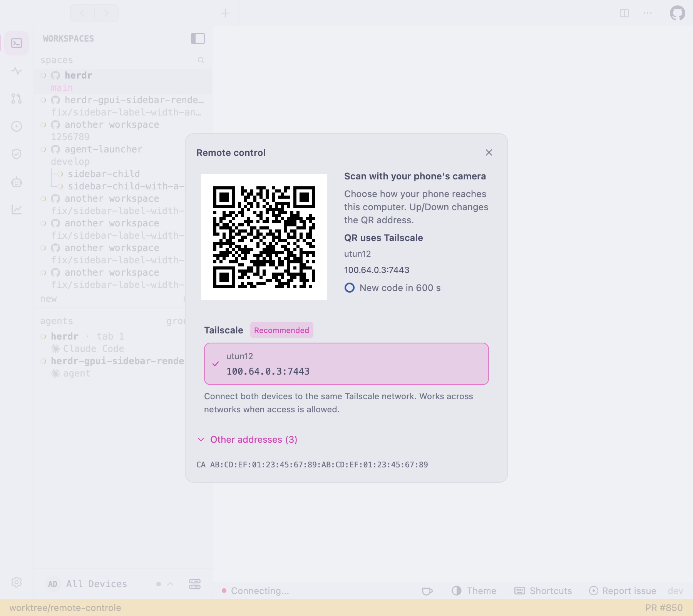
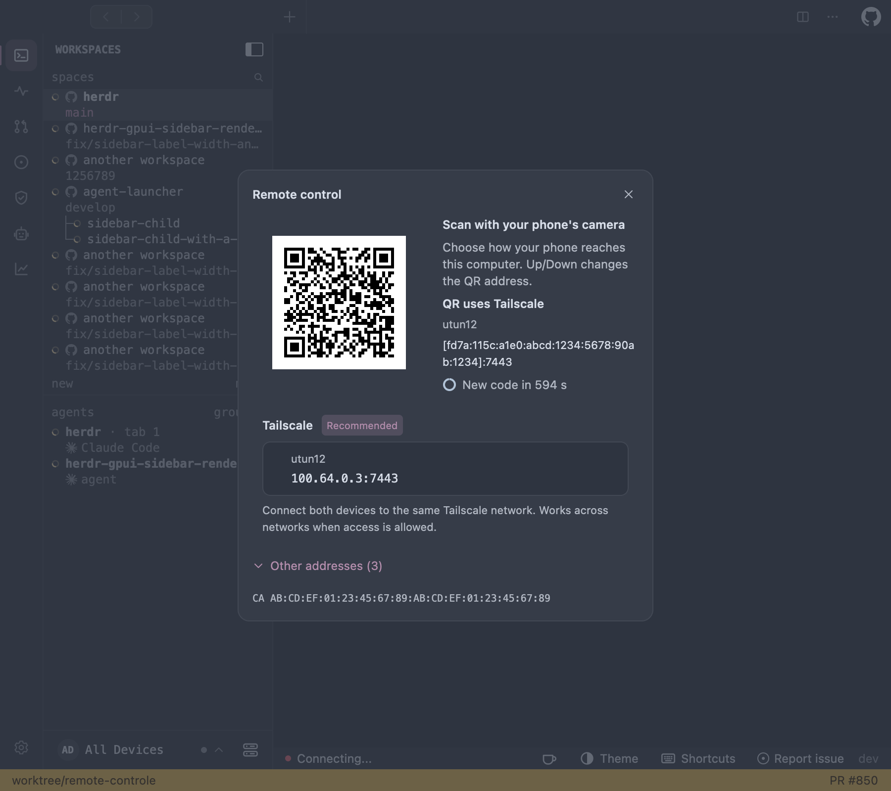
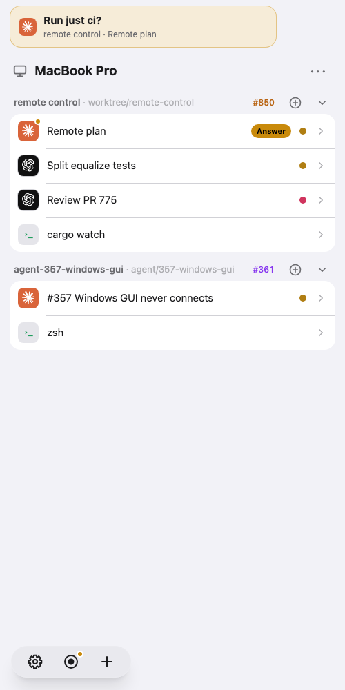
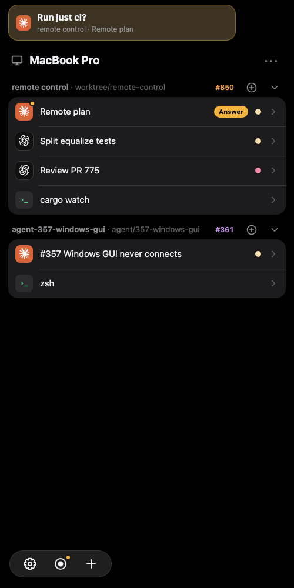
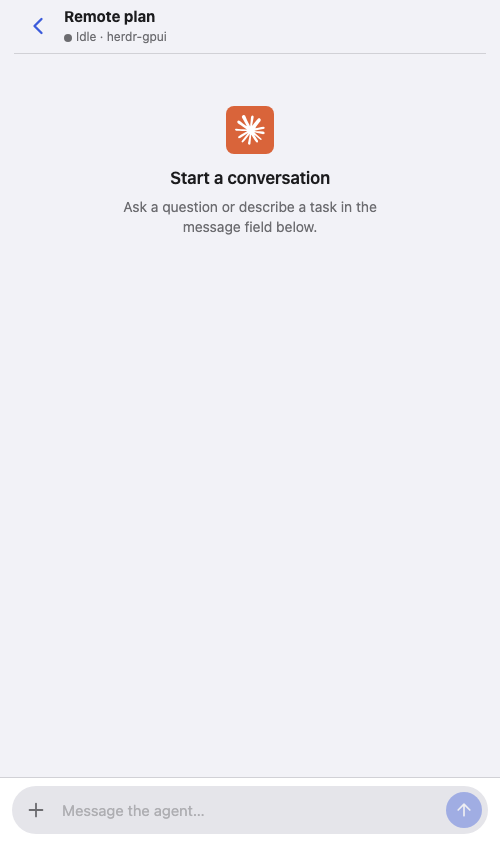

# Remote control daemon

`herdr-remote-control` serves this machine's `herdr-acp` chats to paired phones over
HTTPS: a mobile web app (installable as a PWA) that lists workspaces, follows
chats, answers agent questions, and receives push notifications. The plan is
`docs/remote-control-plan.md`.

The daemon is a user service that Herdr UI installs when Remote control is
turned on, and it keeps running when the app quits. It never starts, stops,
or upgrades a Herdr daemon.

## Control protocol

`control` is the wire between Herdr UI and the daemon: one request and one
response per connection, as length-prefixed JSON frames
(`herdr_chat_protocol::write_frame`) over a private endpoint at
`control::address(state_dir)`. Herdr UI depends on this crate with
`default-features = false`, which leaves out the server and Tokio, and calls
`control::request` from a background thread.

## Pairing and authentication

`auth` (server only) holds the pairing the desktop dialog opens, the paired
devices in `devices.json` (0600, replaced atomically), challenge-signed
sessions, and per-address rate limits. It is synchronous and takes every time
as milliseconds since the Unix epoch, so the server calls it under a mutex and
tests pass explicit times.

The pairing QR prefers a Tailscale address when one is available, then a LAN
address. The desktop dialog highlights the Tailscale connection and reveals
alternatives under **Other addresses**. Each address names its interfaces on
the daemon's host (for example `utun12`, `en0`, or `bridge100`), with a network
label and reachability guidance. A private IP alone does not identify Wi-Fi
versus Ethernet, and a CGNAT address alone does not prove Tailscale. Unknown
interfaces, including those from older daemons, are labelled unavailable.
After a development rebuild, restart the background daemon in Settings >
Remote control and reopen pairing to get the new metadata. An older daemon's
offer shows this instruction in the dialog; rebuilding the GUI alone does not
replace an already-running daemon.
The same metadata is included in `remote status` and its JSON output.
The desktop dialog lets you select any advertised HTTPS address and
keeps that choice when the QR token refreshes. Use Up/Down to select an address
with the keyboard, or Home/End to select the first/last; the selected row stays
visible, automatically revealing alternatives. Right/Left expand/collapse the
other addresses without changing the selection. Escape closes the dialog. For pairing across networks,
connect both devices to the same Tailscale network and allow access to the
remote-control port (7443 by default). Local addresses still work on the same
network. Pair and install the phone app from the stable Tailscale address to
avoid tying its browser origin to temporary Wi-Fi. Bluetooth is not used.

The native pairing dialog, shown with synthetic addresses and an inactive QR:

| Light | Dark |
| --- | --- |
|  |  |

[Expanded alternatives in a narrow native window](../../docs/screenshots/remote-pairing-narrow.png).

## Workspace pull requests and titles

Mobile workspace headers show the PR number and the same readiness/lifecycle
tone as the desktop: green for ready, yellow for pending checks/review, orange
for blocked/behind, red for attention, purple for merged, and muted for drafts
or unknown state. Tapping the badge opens its PR.

Herdr UI publishes its existing PR cache through the private control socket;
no GitHub credentials are sent to the phone and no second lookup is started.
Updates reach open lists through the patch stream. Badges show the last state
reported by the desktop while it is closed; a daemon restart waits for the next
desktop refresh. Boot, workspace, directory, and branch identities must match,
so a recycled workspace cannot inherit another checkout's badge.

Issue-dispatched agents keep explicit issue/PR captions. Old wrapper-only
`pasted_content` titles fall back to useful names on both desktop and phone.

| Light browser preview | Dark browser preview |
| --- | --- |
|  |  |

## Saved certificates and Home Screen pairing

The CA, its key, and server certificates/keys live in the daemon's persistent
`STATE_DIR/tls/` directory (`ca.pem`, `ca-key.pem`, `leaf.pem`, and per-IP
`leaf-ip4-*.pem` / `leaf-ip6-*.pem` files), under Herdr
UI's state directory: for example `~/.local/state/herdr/gpui/remote/tls/`.
Certificate files are private (`0600` on Unix), written
atomically, and reused across ordinary restarts and rebuilds. Each IP has its own
saved server certificate, signed by the same CA: a new LAN IP gets a new leaf
without replacing the Tailscale leaf. Returning IPs reuse their saved certificates.
IP clients normally send no TLS SNI, so the TCP connection's local destination
selects the certificate. DNS names use a separate leaf; custom certificate files
are left alone. Existing shared certificates are migrated without changing the
certificate for any address they still cover. Each leaf renews near its own expiry.
Transient link-local addresses (`169.254.x.x` and `fe80::/10`) are excluded from
pairing discovery so temporary adapters do not rotate a stable connection's certificate.
If a replacement cannot be saved, it is not presented; a running resolver keeps
its existing certificate. Trusting the CA on the phone covers these renewals.

Safari and Home Screen installations have separate storage. Transfer tokens
are single-use and scoped to the browser's current pairing; pairing again
clears an older transfer token. An unpaired Home Screen app can also scan a
fresh desktop pairing code directly, without reinstalling the shortcut.

## Push notifications

`push` (server feature only) sends Web Push: a VAPID key created once at
`STATE_DIR/push/vapid.pem` (0600), RFC 8291 `aes128gcm` encryption, the
HTTPS post to the phone's push service, the triggers that turn chat changes
into questions, finished turns, and errors, and a per-device throttle. The
service worker receives `push::Message` as JSON.

## Empty chats

An empty chat opens at its header with the agent's icon and a prompt to start.
Populated chats open at the latest entry; stream updates follow only while the
reader is already at the bottom. The header uses an opaque background and stays
below the status-bar safe area.

## Browser controller tests

The phone's scroll-controller regression checks run without browser dependencies:
`node --test scripts/test-remote-chat-scroll.mjs scripts/test-remote-handoff.mjs`
from the repository root.
Node is needed only for these optional checks, not for building the daemon.

## Errors

The crate exports `Error` and `Result<T>`.
