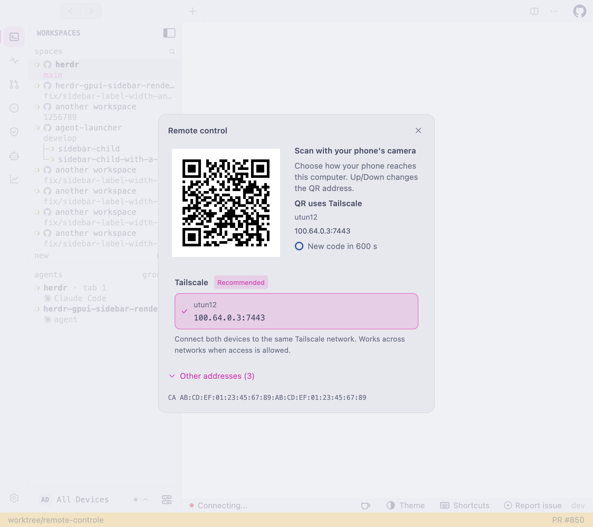
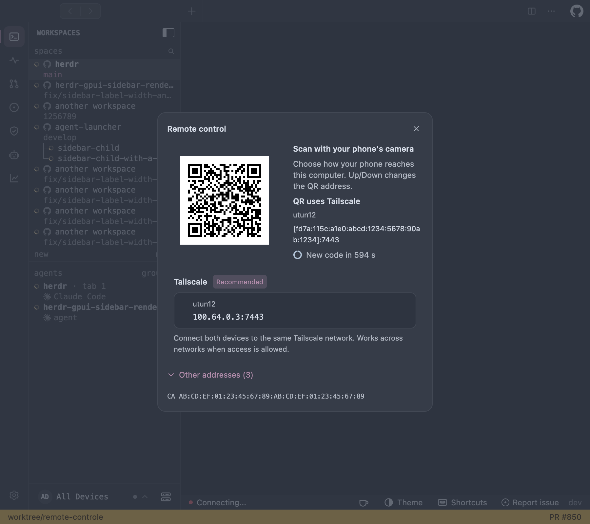
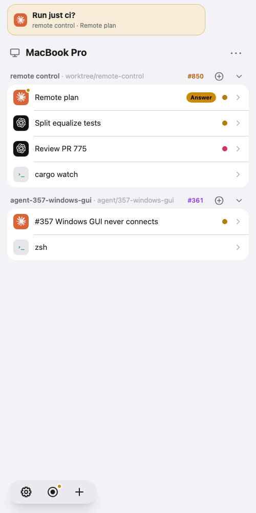
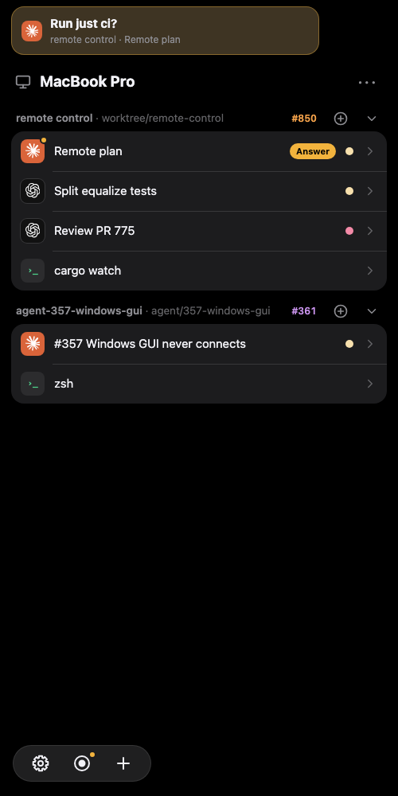
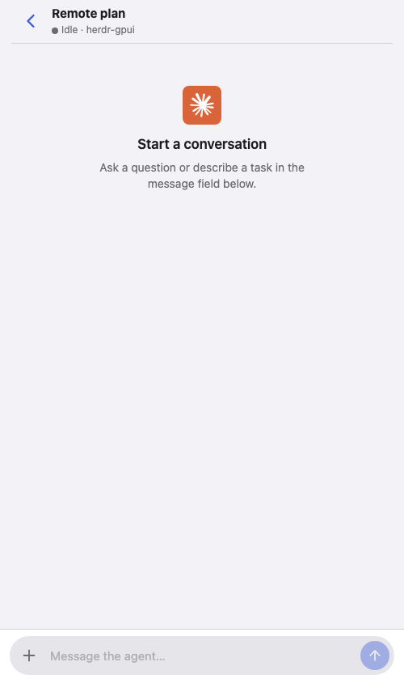

# Remote control daemon

`herdr-remote-control` serves this machine's `sheprd-acp` chats to paired phones over
HTTPS: a mobile web app (installable as a PWA) that lists workspaces, follows
chats, answers agent questions, and receives push notifications. The plan is
`docs/remote-control-plan.md`.

The daemon is a user service that Sheprd installs when Remote control is
turned on, and it keeps running when the app quits. It never starts, stops,
or upgrades a Herdr daemon.

## Herdr 1 sessions

The daemon follows the Herdr 1 session at `--herdr-socket` (discovered when
absent) and every other running session of this user's installation
(`herdr --session NAME`, under `sessions/` in Herdr's configuration
directory), so a computer that runs only named sessions still shows phones
all of them. The installation is the one that socket is in, as the desktop
resolved it, since the service's environment may lack the shell's
`XDG_CONFIG_HOME`. Sessions are listed again every 30 seconds: one started or
stopped later is followed or let go without a restart. A named session's
workspace, tab, and pane ids carry `herdr:NAME:`, and its requests go to its
own API socket. The session at `--herdr-socket` keeps its ids, and desktop
pull request data is matched against it. A new workspace goes to that
session, or to the alphabetically first named session that answers when it
does not.

A socket outside such an installation (a sandbox's, or a development
daemon's) keeps the daemon to that one session: no other is followed. Chats
are bounded across all sessions, the primary's first and then by name.

Pairing a phone gives it this computer, not one session: a paired phone can
read and type into every session the daemon follows, including one started
after it was paired.

## Herdr 2 terminals

The daemon lists terminals from both Herdr 1 and a running herdr-core.
The managed service receives the socket and session resolved by the desktop,
so it joins the same core even when its service environment differs.
A foreground daemon discovers herdr-core through
`HC_SOCKET`, the core's configured socket, or its default session socket.
`HC_SESSION` selects the session. Explicit `--core-socket PATH --core-session NAME`
arguments override discovery. Remote control only joins an existing core.
It never starts the bundled core or runs `hc server start`.

Herdr 1 workspaces and chats keep their existing behavior.

When the Herdr desktop app's `herdr-app` document exists in the core,
the phone shows its local spaces in document order, with their tabs and
split panes. Named spaces keep their names. Unnamed spaces use the first
terminal's current repository or folder, with `~` for home. Spaces from
other machines are omitted. Unlisted terminals stay in **Herdr 2**.
The worker reads the document after a terminal changes and at least every
3 seconds, and parses it only when its version changes. It accepts at most 1 MiB,
256 spaces and tabs, and 16 terminal panes per tab within 16 tree levels.
A malformed or oversized document falls back to Sheprd's saved tabs.

Without a valid document, Herdr 2 tabs in Sheprd's `browser-tabs.json` keep
their workspace and split membership. The file is read beside the explicit
remote `--state-dir`
(for example, `gpui/browser-tabs.json` beside `gpui/remote`), using the
desktop state context instead of the service environment. Only tabs for the
selected local Herdr 1 endpoint are used.
Other core terminals appear in a **Herdr 2** workspace, including terminals
created by `hc` and the desktop's shell when Herdr 1 is absent. Status comes
from the core's terminal records. The phone reports **Herdr not running**
only when neither source answers.

A phone opens a Herdr 2 pane through the same screen and input endpoints
as a Herdr 1 pane. The server uses `sheprd-terminal` to emulate raw core
output and sends complete ANSI screens through the existing stream.
Keys and pastes use the terminal's current modes, including bracketed paste.
The pane opens as an observer at its current dimensions, so watching changes
nothing on the desktop. The first key or paste takes the driver's role at the
terminal's current size. Phone-specific sizing, scrolling,
renaming, splitting, and zooming remain Herdr 1 actions. A phone closes a Herdr 2
pane, or a tab of one pane; a tab of several panes stays open.
The daemon keeps at most 16 shared core attachments and releases each after
30 seconds without a screen read or input request. When all 16 are held, the
one idle longest gives way to a new pane if it has been idle for 5 seconds.

While a core answers, new work from a phone starts there, even from a Herdr 1
pane or workspace: new tabs, chats, and workspaces. Herdr 1 terminals stay listed
and keep working, and a failure is shown rather than retried on Herdr 1. New
work appears in **Herdr 2**, because the desktop owns its spaces. The core has no
worktrees, so a new workspace on a branch is refused. Without a core, new work
goes to Herdr 1.

Phone-created shells recover in place after program loss. Chats do not: if
`sheprd-acp` is lost, the terminal finishes rather than recovering as a shell
that still carries an unavailable chat endpoint label.

## Control protocol

`control` is the wire between Sheprd and the daemon: one request and one
response per connection, as length-prefixed JSON frames
(`sheprd_chat_protocol::write_frame`) over a private endpoint at
`control::address(state_dir)`. Sheprd depends on this crate with
`default-features = false`, which leaves out the server and Tokio, and calls
`control::request` from a background thread.

## Pairing and authentication

`auth` (server only) holds the pairing the desktop dialog opens, the paired
devices in `devices.json` (0600, replaced atomically), challenge-signed
sessions, and per-address rate limits. It is synchronous and takes every time
as milliseconds since the Unix epoch, so the server calls it under a mutex and
tests pass explicit times.

### Updating from a phone

`POST /api/v2/update` asks Sheprd to update, and this daemon only relays
(`control::app_update`). Sheprd sends `AppUpdate` with each poll while a window
runs its updater, and the answer hands it a phone's request, which its updater
carries out up to the restart. Each report names the app's process, and a
request goes only to the run a phone saw, so it cannot update unseen an app
reopened later, however soon. Without a report for 15 seconds the app counts as
closed and a request is refused. A machine with no app open
cannot update from a phone.

### Other machines

Allowing a phone also pairs it directly with the SSH and cloud machines Herdr
UI connects to (`control::hosts`, `auth::links`). This daemon only relays.
Sheprd names the machines with `Hosts`, and the desktop's `Approve` lists
the ticked ones. The phone sends one new key per machine to
`POST /api/v2/hosts/{host}/pair`. Sheprd takes each request
(`HostPairings`) and reports back (`HostPaired`). Revoking a phone owes each
machine a revocation, kept in `host-revokes.json` until Sheprd clears it.

On a machine, Sheprd runs `sheprd-remote-control enroll` over SSH, which
`app::enroll` implements. It takes the phone's key and this computer's APNs
files on stdin. It installs the user service unless one is installed, turns
on `[remote]` in that machine's Sheprd settings when there are any, and
asks the running daemon to add the phone (`Enroll`). Then it prints the
machine's fingerprint and addresses. `sheprd-remote-control revoke --device ID`
undoes it.

The pairing QR prefers a Tailscale address when one is available, then a LAN
address. The desktop dialog highlights the Tailscale connection and reveals
alternatives under **Other addresses**. Each address names its interfaces on
the daemon's host (for example `utun12`, `en0`, or `bridge100`), with a network
label and reachability guidance. A private IP alone does not identify Wi-Fi
versus Ethernet, and a CGNAT address alone does not prove Tailscale. Unknown
interfaces, including those from older daemons, are labelled unavailable.
After a development rebuild, restart the background daemon in Settings >
Remote control and reopen pairing to get the new metadata. An older daemon's
offer shows this instruction in the dialog; rebuilding the GUI alone does not
replace an already-running daemon.
The same metadata is included in `remote status` and its JSON output.
The desktop dialog lets you select any advertised HTTPS address and
keeps that choice when the QR token refreshes. Use Up/Down to select an address
with the keyboard, or Home/End to select the first/last; the selected row stays
visible, automatically revealing alternatives. Right/Left expand/collapse the
other addresses without changing the selection. Escape closes the dialog. For pairing across networks,
connect both devices to the same Tailscale network and allow access to the
remote-control port (7443 by default). Local addresses still work on the same
network. Pair and install the phone app from the stable Tailscale address to
avoid tying its browser origin to temporary Wi-Fi. Bluetooth is not used.

The native pairing dialog, shown with synthetic addresses and an inactive QR:

| Light | Dark |
| --- | --- |
|  |  |

[Expanded alternatives in a narrow native window](../../docs/screenshots/remote-pairing-narrow.png).

## Workspace pull requests and titles

Mobile workspace headers show the PR number and the same readiness/lifecycle
tone as the desktop: green for ready, yellow for pending checks/review, orange
for blocked/behind, red for attention, purple for merged, and muted for drafts
or unknown state. Tapping the badge opens its PR.

Sheprd publishes its existing PR cache through the private control socket;
no GitHub credentials are sent to the phone and no second lookup is started.
Updates reach open lists through the patch stream. Badges show the last state
reported by the desktop while it is closed; a daemon restart waits for the next
desktop refresh. Boot, workspace, directory, and branch identities must match,
so a recycled workspace cannot inherit another checkout's badge.

Issue-dispatched agents keep explicit issue/PR captions. Old wrapper-only
`pasted_content` titles fall back to useful names on both desktop and phone.

| Light browser preview | Dark browser preview |
| --- | --- |
|  |  |

## Saved certificates and Home Screen pairing

The CA, its key, and server certificates/keys live in the daemon's persistent
`STATE_DIR/tls/` directory (`ca.pem`, `ca-key.pem`, `leaf.pem`, and per-IP
`leaf-ip4-*.pem` / `leaf-ip6-*.pem` files), under Herdr
UI's state directory: for example `~/.local/state/herdr/gpui/remote/tls/`.
Certificate files are private (`0600` on Unix), written
atomically, and reused across ordinary restarts and rebuilds. Each IP has its own
saved server certificate, signed by the same CA: a new LAN IP gets a new leaf
without replacing the Tailscale leaf. Returning IPs reuse their saved certificates.
IP clients normally send no TLS SNI, so the TCP connection's local destination
selects the certificate. DNS names use a separate leaf; custom certificate files
are left alone. Existing shared certificates are migrated without changing the
certificate for any address they still cover. Each leaf renews near its own expiry.
Transient link-local addresses (`169.254.x.x` and `fe80::/10`) are excluded from
pairing discovery so temporary adapters do not rotate a stable connection's certificate.
If a replacement cannot be saved, it is not presented; a running resolver keeps
its existing certificate. Trusting the CA on the phone covers these renewals.

Safari and Home Screen installations have separate storage. Transfer tokens
are single-use and scoped to the browser's current pairing; pairing again
clears an older transfer token. An unpaired Home Screen app can also scan a
fresh desktop pairing code directly, without reinstalling the shortcut.

## Push notifications

`push` (server feature only) sends Web Push: a VAPID key created once at
`STATE_DIR/push/vapid.pem` (0600), RFC 8291 `aes128gcm` encryption, the
HTTPS post to the phone's push service, the triggers that turn chat changes
into questions, finished turns, and errors, and a per-device throttle. The
service worker receives `push::Message` as JSON.

The app's badge counts agents that want the user (`web::attention`): those
with a question, those Herdr reports blocked, and those that finished and
nobody has opened on a phone or focused in a Herdr client. A background push
moves it when the count changes, and iOS may delay or drop those, so the
number is exact only once the app is open.

## Empty chats

An empty chat opens at its header with the agent's icon and a prompt to start.
Populated chats open at the latest entry; stream updates follow only while the
reader is already at the bottom. The header uses an opaque background and stays
below the status-bar safe area.

## Browser controller tests

The phone's scroll-controller regression checks run without browser dependencies:
`node --test scripts/test-remote-chat-scroll.mjs scripts/test-remote-handoff.mjs`
from the repository root.
Node is needed only for these optional checks, not for building the daemon.

## Errors

The crate exports `Error` and `Result<T>`.
